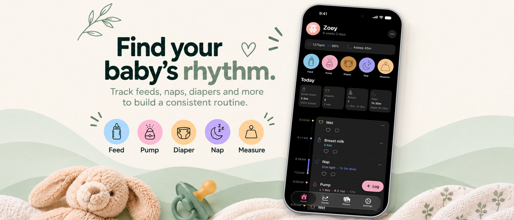
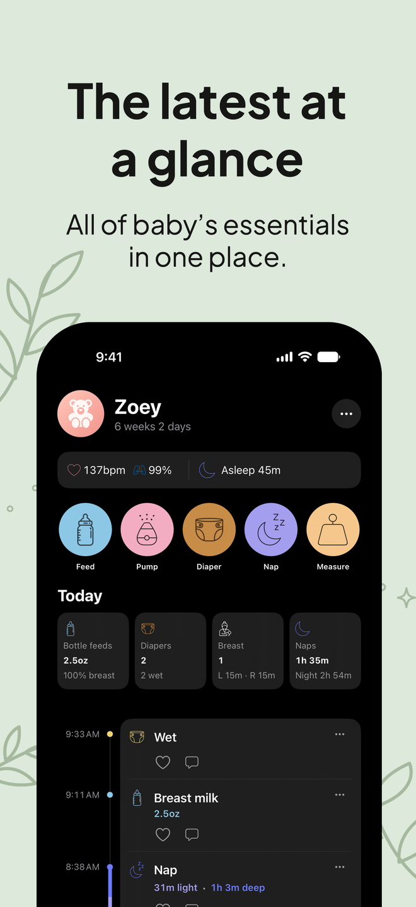
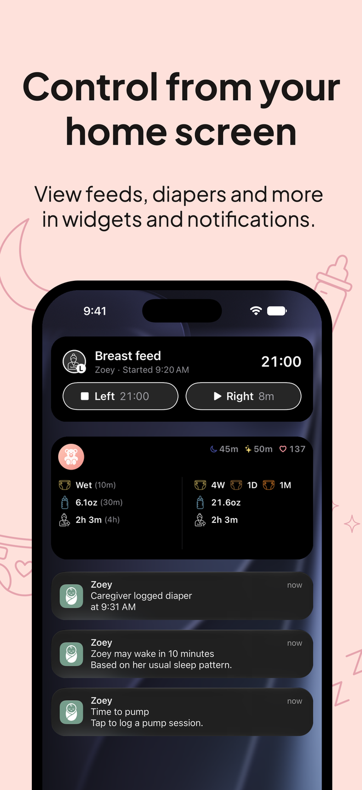
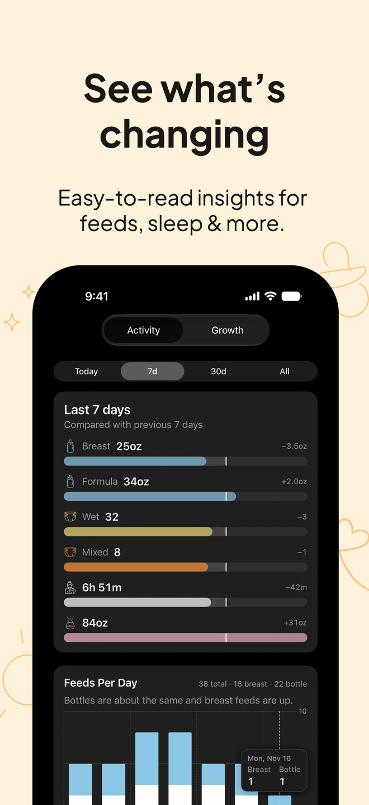
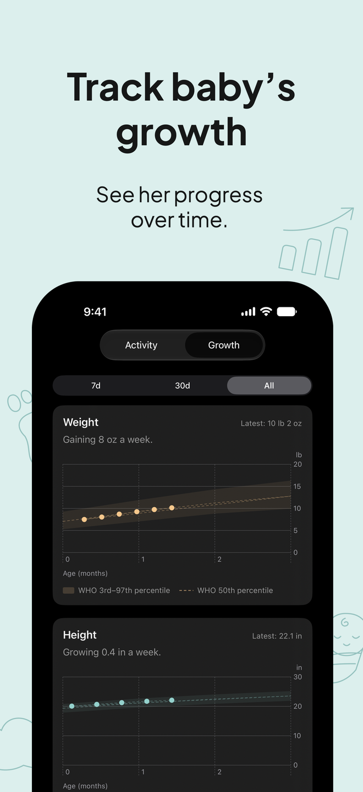
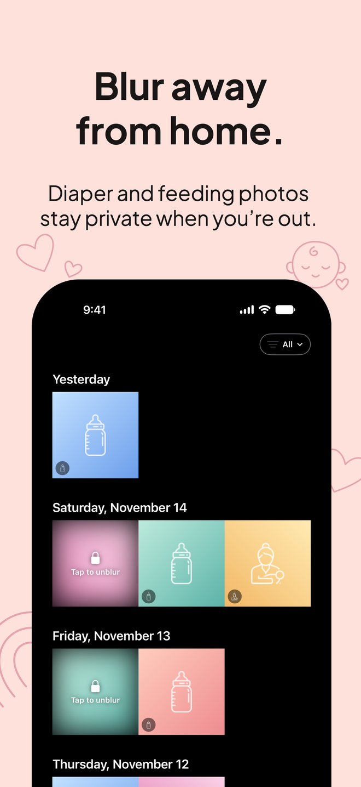

    
    

        <h3 class="mt-0"><a href="/zoey-baby">Zoey Baby</a></h3>
        
A fast, private baby tracker. Feedings, solids, diapers, sleep, pumping, and growth, synced between you and your partner over iCloud.

        <ul class="text-left">
            <li>Log bottles, breast feeds, solids, diapers, pumping, naps, growth, temperature, medicine, baths and milestones, with a photo on anything you log.</li>
            <li>Solids with a food picker and a face for how each one went: liked it, so-so, disliked it, or allergic.</li>
            <li>Vitamin D drops ticked off on a bottle or breast feed.</li>
            <li>Live breast feed and pump timers that either parent can start, switch sides on, or stop, from whichever phone is nearest.</li>
            <li>Sync with your partner over iCloud, with a ping when they log something. No accounts, no third-party servers, no ads.</li>
            <li>Like and comment on what your partner logs.</li>
            <li><a href="/zoey-baby/home-assistant">Home Assistant integration</a> for smart sock readings: heart rate, oxygen, and sleep state.</li>
            <li>Naps written down from the sensor, with a daily total for naps and one for the night, split at the wake time and bedtime you set. A nap you log or end by hand stays exactly as you left it.</li>
            <li>Sleep alerts when the sensor reports your baby falling asleep, going deep, or waking up.</li>
            <li>Nap prediction off the wake windows your baby actually keeps, with an alert before the next likely sleep or wake.</li>
            <li>Photos that blur themselves whenever you are away from home, on the kinds of event you choose.</li>
            <li>Siri support: log feeds, ask when the last diaper was, all in your Settings unit.</li>
            <li>Home Screen widgets you configure per baby, including one with the latest photo, an Apple Watch app for logging from your wrist, and Live Activities on the Lock Screen and Dynamic Island.</li>
            <li>Trends over 7 days, 30 days, or all time, and growth charts against WHO percentile curves.</li>
            <li>Reminders to pump at the times you set, for bath night every few days, and at noon on any day vitamin D drops haven't been logged, through the first year.</li>
            <li>Export a whole history, photos included, as a single file you can import again later, or bring one over from another app.</li>
        </ul>
        
Download on the <a href="https://apps.apple.com/us/app/id6786016688">iOS App Store</a>.

        
Setting up the sensors? See the <a href="/zoey-baby/home-assistant">Home Assistant guide</a>. Coming from another app? See the <a href="/zoey-baby/export-converter">import format guide</a>.

    

<h3 class="mt-5 mb-3">Screenshots</h3>

    

        <figure class="shot mb-0">
            
        </figure>
    

    

        <figure class="shot mb-0">
            
        </figure>
    

    

        <figure class="shot mb-0">
            
        </figure>
    

    

        <figure class="shot mb-0">
            
        </figure>
    

    

        <figure class="shot mb-0">
            
        </figure>
    

    

        <figure class="shot mb-0">
            
        </figure>
    

    

        <figure class="shot mb-0">
            
        </figure>
    

