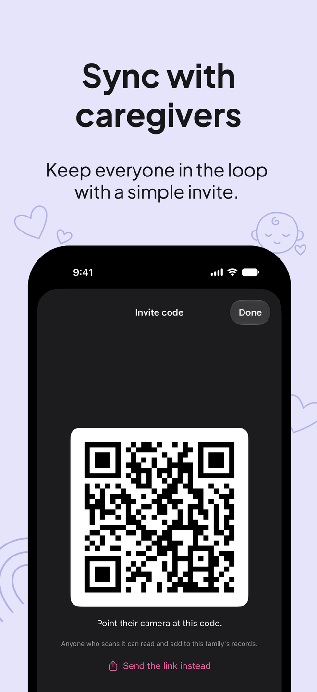
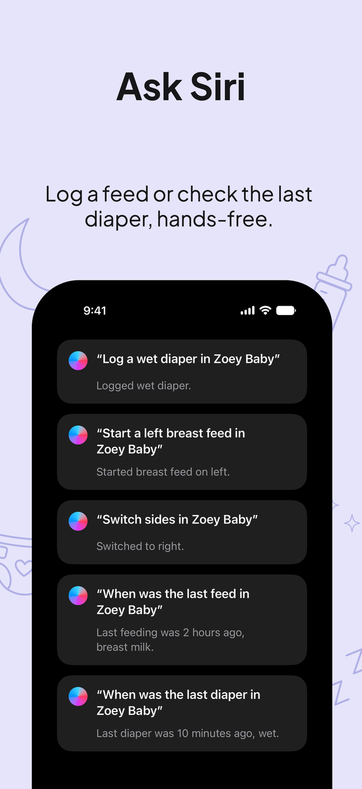

    
    

        <h3 class="mt-0"><a href="/zoey-baby">Zoey Baby</a></h3>
        
Zoey Baby is a private baby tracker on iOS and stores your data in your private iCloud.

        <ul class="text-left">
            <li><strong>Logging:</strong> feeds, solids, diapers, sleep, pumping, growth and more, each with an optional photo.</li>
            <li><strong>Live timers:</strong> breast feed and pump timers either parent can start, switch or stop.</li>
            <li><strong>Partner syncing:</strong> over iCloud, with a ping, a like or a comment on what they log. No accounts, no ads.</li>
            <li><strong>Smart sock:</strong> <a href="/zoey-baby/home-assistant">Home Assistant integration</a> for vitals, automatic naps, sleep alerts and nap prediction.</li>
            <li><strong>Deep Apple integration:</strong> Siri, widgets, Apple Watch, and Live Activities on the Lock Screen and Dynamic Island.</li>
            <li><strong>Insights:</strong> trends, WHO growth charts, and reminders for pumping, bath night and vitamin D.</li>
            <li><strong>Privacy:</strong> photos that blur when you're away from home, and a full export you can import again or bring over from another app.</li>
        </ul>
        
Download on the <a href="https://apps.apple.com/us/app/id6786016688">iOS App Store</a>.

        
Setting up the sensors? See the <a href="/zoey-baby/home-assistant">Home Assistant guide</a>. Coming from another app? See the <a href="/zoey-baby/export-converter">import format guide</a>.

    

<h3 class="mt-5 mb-3">Screenshots</h3>

    

        <figure class="shot mb-0">
            
        </figure>
    

    

        <figure class="shot mb-0">
            
        </figure>
    

    

        <figure class="shot mb-0">
            
        </figure>
    

    

        <figure class="shot mb-0">
            
        </figure>
    

    

        <figure class="shot mb-0">
            
        </figure>
    

    

        <figure class="shot mb-0">
            
        </figure>
    

    

        <figure class="shot mb-0">
            
        </figure>
    

